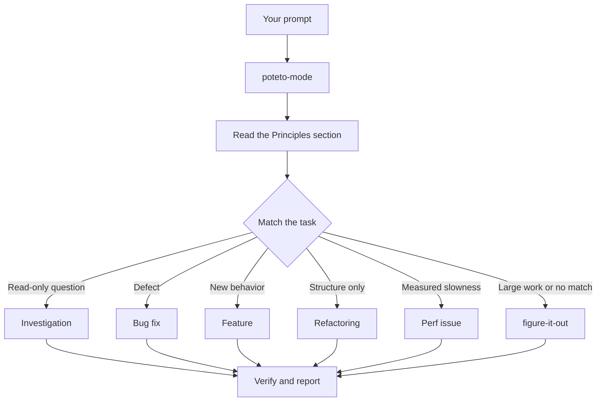

# 让工作走 `/poteto-mode`

`/poteto-mode` 是正门。你给它一个目标，它匹配二十三份行动手册中的一份，把那份行动手册的步骤复制进待办列表，并在步骤需要时调用其他 skill。在这一页，你将了解一条好的提示词长什么样，以及你实际上需要写的有多么少。


## 你的提示词会怎样



这张图显示的是常见路由。还有这些行动手册：针对一个指标做爬山优化，诊断运行时症状和已采集的 trace，原型，视觉一致，编写和评测 skill，自主运行，开 PR，把一个 PR 或一条栈看护到可合并，合入一条已验证的栈，用 autopilot 跑一个 PR 队列或一条栈，编排项目规模的工程，会话接手，安全暂停，多阶段计划，以及工作树清理。完整的一套在[行动手册目录](../../skills/poteto-mode/playbooks/)。

## 说目标，不说仪式

你不用写规格。你说出哪里不对，或者你想要什么，再加上任何你已经知道、能给 agent 省时间的事：

```text
/poteto-mode users get two notifications after a retry. repro first, then fix and verify.
```

这是一条缺陷修复提示词。“repro first” 是一条真正的约束，不是客套，行动手册会遵守它。看待办列表被缺陷修复的步骤填满。被跳过的步骤仍然可见，并带上 `skip: <reason>`。

## 提示词里放什么

一条有用的提示词最多带五样东西，每一样都放得进一句话：

- **目标。** 说出哪里不对，或者你想要什么。
- **完成核对。** 它必须能够通过或失败。“让它变得更好”和“在这上面干一个小时”都不是核对。
- **你想看到的证明。** 去要真实的命令输出、这段流程的视频、存下来的值，或一个改前改后的数字。
- **你已经知道的。** 一个症状、一步复现、一行日志或一个链接，能给 agent 省掉一次搜索。
- **真正的约束。** “repro first”、“don't change any code yet”、“zero behavior change” 和 “let me review before proceeding” 各自都会改变 agent 做什么。

下面是一条五样都有的提示词：

```text
/poteto-mode the csv export drops its last row since yesterday's deploy. failing job id is 4812. repro first, then fix. done means the 60k-row fixture exports every row. show me the row counts before and after.
```

有两样东西值得留在外面：

- **做法。** 说出要达成什么，给 agent 留出空间，去找一条比你会选的更好的路径。技能列表也一样，见下面的陷阱。
- **你对原因的推测，先别说。** 一个说出来的猜测，会把搜索收窄到你指的那个地方。先让 agent 复述问题，再分享你的预感。

对于一份嘈杂的报告，比如一条长线程或一个含糊的 bug，把复述当作第一步：

```text
/poteto-mode read this thread. restate the underlying issue in your own words, in plain english. don't change any code yet.
```

误读会在复述里暴露出来，此时还没有任何代码。在那里纠正，代价是一条消息，而不是一次改错的修复。如果只要复述、不要行动手册，运行 [`/in-your-own-words`](../../skills/in-your-own-words/SKILL.md)。它复述 agent 所认为的你的目标，以及你想解决的问题。

当你不确定一条提示词是否对准了，在发送之前先对它运行 [`/sharpen`](../../skills/sharpen/SKILL.md)：

```text
/sharpen write a migration guide for the v2 config format.
```

agent 会说出顶尖专业人士会做哪些你没开口要的事，他们会从最原始的什么材料起步，他们会用的方法和工具，以及除了你或 agent 之外，什么能表明结果是对的。然后它改写你的提示词，让它正好要这些，更深，但不是更大，并让你的选择保持开放。它不执行任务。读那份改写，然后发送它，例如配上 `/poteto-mode`。

## 后续从短

当对话里已经带着上下文，提示词会缩到几乎什么都没有。下面这些就都够了：

```text
/poteto-mode do it
```

```text
continue
```

```text
keep going until done
```

短之所以有效，是因为行动手册持有结构，而自定义模式让 `/poteto-mode` 在每一轮都留在上下文里。如何开一个，见 [安装 pstack](./01-setup.md#run-your-first-task)。你的话承载意图，skill 承载严格性。

## 用 “new task” 切换任务

长对话会积累上一个任务的上下文。当你换话题时，说出来：

```text
/poteto-mode new task. figure out why the cache entry survives logout. don't change any code yet.
```

“new task” 告诉 `/poteto-mode` 重新匹配，而不是延续上一份行动手册。“don't change any code yet” 把这一次钉在调查上。没有这两句，一个正处在功能行动手册中途的 mode，往往会把你的问题当成下一步功能步骤。

## 让并行工作各自有一台机器

如果你在一台电脑上对同一个仓库跑好几个 agent，它们会争工作区、端口和构建产物。最干净的隔离是[云端子 agent](https://cursor.com/docs/subagents#cloud-subagents)。每一个都有自己的虚拟机和分支，所以它可以安装依赖、运行你的应用、把结果录成视频，而不碰你的机器。在任务之前输入 `/in-cloud`，或者让父对话把工作交给云端子 agent。

当工作必须留在本地时，事先要一个工作树：

```text
/poteto-mode new task. branch off <base> in a fresh worktree, then port the parser change there.
```

每个任务用自己的分支和工作树，就没有 agent 会踩到另一个的文件。工作树消耗磁盘和机器资源，所以一台笔记本一次只能跑有限几个。[开 PR 行动手册](../../skills/poteto-mode/playbooks/opening-a-pr.md)对代码改动已经会从工作树开始做，所以多数时候只有在特定基线或位置要紧时，你才需要说这个。

工作树会越积越多。磁盘紧张时，可以问：

```text
/poteto-mode what's eating my disk? prune the worktrees that are safe to prune.
```

[工作树清理行动手册](../../skills/poteto-mode/playbooks/worktree-cleanup.md)按合并状态、未提交的工作，以及哪些对话还在碰它，给每个工作树分类。它只删除证据放行的那些，凡是还握着未提交工作的，就停下来等你决定。

## 让它继续跑

当你走开时，说清做完意味着什么，然后离开：

```text
/poteto-mode im stepping away. keep going until the migration check reports zero old callers. log your decisions.
```

你稍后才评审的工作会经由 [`/figure-it-out`](../../skills/figure-it-out/SKILL.md) 路由，它会设计这次运行的阶段，并保留一份 [`/show-me-your-work`](../../skills/show-me-your-work/SKILL.md) 决策日志。[在你睡觉时跑工作](./07-overnight.md)讲完整的通宵约定。

**陷阱：** 不要在提示词里枚举 skill（“use /how, then /architect, then /arena...”）。行动手册已经排好了它们的顺序，手写的顺序通常会重排或丢掉行动手册本来会保留的步骤。只有在你想覆盖某个具体选择时，才点名一个 skill。

完整的路由规则见 [`poteto-mode`](../../skills/poteto-mode/SKILL.md) 本身。

下一篇：[理解代码](./03-understand.md)。
