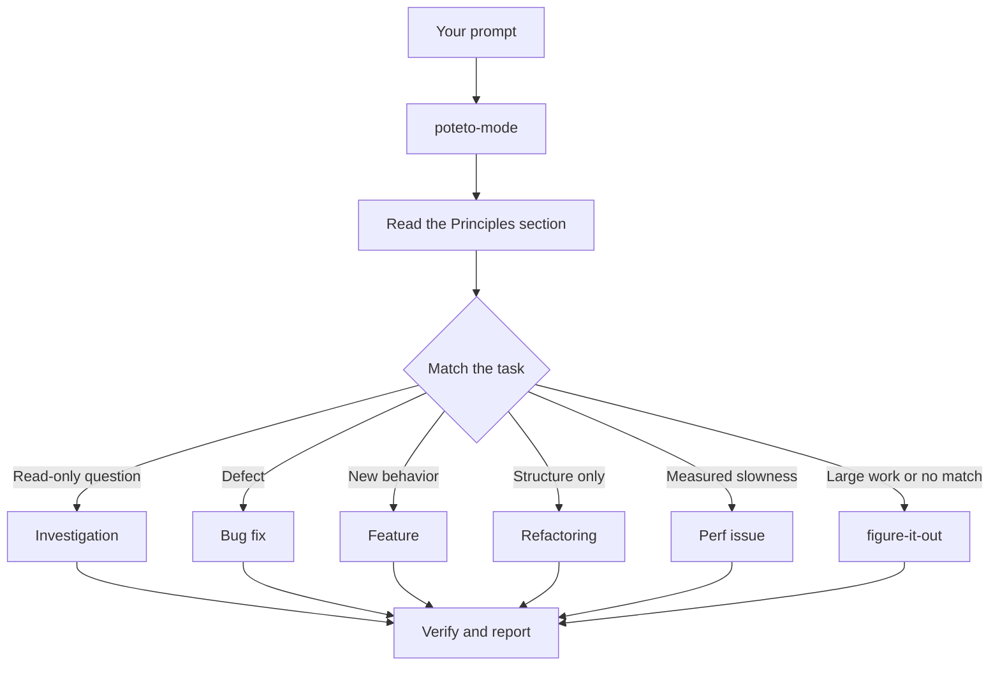

# 通过 `/poteto-mode` 路由工作

`/poteto-mode` 是前门。你给它一个目标，它匹配二十三个作战手册中的一个，把该作战手册的步骤复制到待办列表里，并在步骤需要时调用其他技能。这一页讲一个好的提示词长什么样，以及你实际需要写多少。


## 你的提示词会经历什么



这张图画的是常见路线。此外还有这些作战手册：对某个指标做爬山优化、诊断运行时症状和抓取的 trace、原型、视觉一致性、编写和评估技能、自主运行、开 PR、照看一个 PR 或栈直到可合并、交付一个已验证的栈、自动跑一个 PR 队列或一个栈、编排项目级的大工程、接续会话、安全暂停、多阶段计划，以及 worktree 清理。[作战手册目录](../../skills/poteto-mode/playbooks/)有完整的一套。

## 说目标，别说仪式

你不用写规格说明。你说哪里不对、或者你想要什么，再加上你已经知道、能帮智能体省时间的信息：

```text
/poteto-mode users get two notifications after a retry. repro first, then fix and verify.
```

这是一个 Bug fix 提示词。"repro first" 是真实约束，不是客套，作战手册会照办。看着待办列表被 Bug fix 的步骤填满。被跳过的步骤会带着 `skip: <reason>` 留在列表里。

## 提示词里放什么

一个有用的提示词最多带五样东西，每样一句话就够：

- **目标。** 说哪里不对，或者你想要什么。
- **完成检查。** 它必须能通过或失败。"做得更好"和"干一个小时"都不算检查。
- **你想看到的证据。** 要真实的命令输出、流程的录屏、存下来的值，或者前后对比的数字。
- **你已经知道的东西。** 一个症状、一个复现步骤、一行日志、一个链接，都能帮智能体省掉一次搜索。
- **真实约束。** "repro first"、"先别改任何代码"、"零行为变化"、"让我先看过再继续"，每一条都会改变智能体的做法。

下面这个提示词五样都有：

```text
/poteto-mode the csv export drops its last row since yesterday's deploy. failing job id is 4812. repro first, then fix. done means the 60k-row fixture exports every row. show me the row counts before and after.
```

有两样东西值得省掉：

- **怎么做。** 说清要达成什么，给智能体留出空间，让它找到比你选的更好的路径。列一串技能也一样，下面"坑"那节会讲。
- **一开始别讲你对原因的理论。** 说出猜测会把搜索范围收窄到你指的地方。先让智能体复述问题，再讲你的猜想。

面对一份嘈杂的报告，比如一个长串回复或一个含糊的 bug，把复述作为第一步：

```text
/poteto-mode read this thread. restate the underlying issue in your own words, in plain english. don't change any code yet.
```

理解错了会在复述里露出来，那时还没有任何代码。在那里纠正，代价是一条消息，而不是一次错误的修复。如果只要复述、不要作战手册，运行 [`/in-your-own-words`](../../skills/in-your-own-words/SKILL.md)。它会复述智能体认为你的目标是什么、你想解决什么问题。

拿不准一个提示词有没有对准方向时，发出去之前先跑一遍 [`/sharpen`](../../skills/sharpen/SKILL.md)：

```text
/sharpen write a migration guide for the v2 config format.
```

智能体会说出：顶尖专业人士会做哪些你没要求的事、他们会从什么最原始的材料起步、会用哪些方法和工具、除了你或智能体之外还有什么能证明结果是对的。然后它重写你的提示词，把这些都问进去，更深但不更大，同时把你的选择留着。它不执行任务。读一遍重写后的提示词，再发出去，比如配上 `/poteto-mode`。

## 追问要短

当对话里已经带着上下文，提示词可以缩到几乎不存在。下面这些都够：

```text
/poteto-mode do it
```

```text
continue
```

```text
keep going until done
```

短能行，是因为作战手册撑着结构，而 Custom Mode 让 `/poteto-mode` 在每一轮都留在上下文里。[设置 pstack](./01-setup.md#run-your-first-task) 讲了怎么启动一个。你的话带意图，技能带严谨。

## 用 "new task" 切换任务

长对话会累积上一个任务的上下文。换话题时，说出来：

```text
/poteto-mode new task. figure out why the cache entry survives logout. don't change any code yet.
```

"new task" 让 `/poteto-mode` 重新匹配，而不是接着上一个作战手册走。"don't change any code yet" 把这一次钉在 Investigation 上。没有这两句，一个正处在 Feature 中途的模式容易把你的问题当成下一个 feature 步骤。

## 并行工作给它自己的机器

如果你在一台电脑上对同一个仓库跑好几个智能体，它们会抢工作树、端口和构建产物。最干净的隔离是[云端子智能体](https://cursor.com/docs/subagents#cloud-subagents)。每个都有自己的 VM 和分支，可以装依赖、跑你的应用、录下结果视频，而不碰你的机器。在任务前打 `/in-cloud`，或者让父对话把活交给云端子智能体。

当工作必须留在本地时，提前要一个 worktree：

```text
/poteto-mode new task. branch off <base> in a fresh worktree, then port the parser change there.
```

每个任务有自己的分支和 worktree，就没有智能体会踩到别人的文件。worktree 要占磁盘和机器资源，所以一台笔记本同时只能跑几个。[开 PR 作战手册](../../skills/poteto-mode/playbooks/opening-a-pr.md)在改代码时本来就从 worktree 出发，所以多数时候你只在某个特定的 base 或位置有讲究时才说这句。

worktree 会越积越多。磁盘紧张时，问：

```text
/poteto-mode what's eating my disk? prune the worktrees that are safe to prune.
```

[Worktree 清理作战手册](../../skills/poteto-mode/playbooks/worktree-cleanup.md)按合并状态、未提交的工作、以及还有哪些对话在碰它，给每个 worktree 分类。它只删证据允许删的，遇到还压着未提交工作的就停下来等你决定。

## 让它自己跑

你走开时，说清什么算完成，然后走：

```text
/poteto-mode im stepping away. keep going until the migration check reports zero old callers. log your decisions.
```

你之后要审的工作会走 [`/figure-it-out`](../../skills/figure-it-out/SKILL.md)，它设计这次运行的各个阶段，并留一份 [`/show-me-your-work`](../../skills/show-me-your-work/SKILL.md) 决策日志。[在你睡觉时跑活](./07-overnight.md)讲了完整的过夜约定。

**坑：** 别在提示词里罗列技能（"先用 /how，再用 /architect，再用 /arena……"）。作战手册已经排好了顺序，手写的顺序通常会打乱或丢掉作战手册本来会保留的步骤。只有想覆盖某个具体选择时，才点名一个技能。

完整的路由规则读 [`poteto-mode`](../../skills/poteto-mode/SKILL.md) 本身。

下一步：[理解代码](./03-understand.md)。
