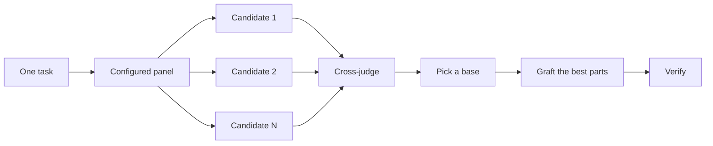

# 写代码之前先设计

对一个难设计只尝试一次，会把模型想到的第一种形状锁死。`/architect` 在实现之前定下类型和边界。`/arena` 对同一份简报跑好几次尝试，并合并最好的部分。`/interrogate` 让其他模型试着打破结果。当这份工作是覆盖而不是设计综合时，`/swarm` 扇出切片或赛跑，并汇总它们的结果。

两种最常见的设计错误，是采纳 agent 的第一份设计，以及打磨一份还没有任何代码检验过的计划。这一页把两者都补上。你通过代码来计划。原型回答开放问题，一份 README 或教程定下目标，写下来的计划放在最后。


## 用 `/architect` 定下形状

```text
/architect design the import pipeline before writing any code. i care most about how callers use it.
```

[`/architect`](../../skills/architect/SKILL.md) 先把自己安放到地面上，对设计触及的代码运行 `/how`，在它移动所有权或分层时运行 `/why`。然后它运行 `/arena`，产出相互竞争的设计草图，每一份都先写调用方的用法，接着是类型、签名和一张模块图。

默认情况下，它从综合出来的设计直接进入实现。如果你想先看见设计，就说出来：

```text
/architect with checkpoint. stop and show me before implementing.
```

代码一开始，设计就不是神圣的。如果实现在互不相关的地方露出同一套变通办法，或者类型只有靠 `any` 或强制转换才能编译，`/architect` 就把这当作设计是错的证明。它丢掉草图重新开始，而不是绕着它打补丁。

## 用 `/arena` 扇出多次尝试

```text
/arena take my prompt to the arena verbatim. i want to compare their proposals with yours.
```

[`/arena`](../../skills/arena/SKILL.md) 是底下的通用工具。N 个子 agent 并行尝试同一份设计或代码简报，每一个写到自己的工作树或目录。一个来自另一个模型族的只读裁判，按一份评分标准给每个候选打分。当没有其他家族的模型能跑时，协调者跳过裁判，自己选定底稿。协调者把每个候选从头读到尾，选定一份底稿，从落选者那里嫁接进最好的想法，并验证结果。



面板来自你的 [`/setup-pstack`](../../skills/setup-pstack/SKILL.md) 配置，你也可以按任务调整它。决定要紧时多要几个候选，不要紧时少要几个：

```text
/arena this, 5 candidates. the cache key format is expensive to change later.
```

## 用 `/swarm` 覆盖切片和赛跑

```text
/swarm check every package under packages/ against its check.sh. one worker per package. one report.
```

[`/swarm`](../../skills/swarm/SKILL.md) 把 N 个工作者扇出到独立切片、覆盖矩阵、gauntlet 分道、探索分区，或预先声明的赛跑臂上。每个工作者有自己的范围和核对，然后报告 `PASS`、`ISSUES` 或 `BLOCKED`。父级等待这些工作者，并返回一份紧凑的报告，带上任何缺口或掉队。

当并行能买到覆盖，或能让相互独立的核对去赛跑时，就用它。`/arena` 给每个工作者同一份设计或代码简报，然后选定底稿并嫁接最好的部分。`/swarm` 覆盖切片，或按事先声明的选择规则跑一场赛跑。它不用选定底稿和嫁接那套仪式。

## 用 `/interrogate` 打破它

```text
/interrogate the whole branch, but skeptically. no nitpicks unless it's an actual bug or regression.
```

[`/interrogate`](../../skills/interrogate/SKILL.md) 把这次改动及其意图交给配置好的模型上的对抗者，每一个都试着用一次针对真实代码的运行来打破它。对抗者找到的失败各不相同。一项发现只有在重跑它的命令时显示出一次破坏意图的失败，才会留下来。报告列出每一项已验证的发现以及找到它的对抗者，然后是每个对抗者丢掉了什么以及为什么，并且什么都不应用。

Dropped 清单也要读。你可以推翻这份裁决。

## 做原型，而不是辩论

绝不要采纳第一份设计。要几份，然后从你看得见的证据里挑：

```text
/poteto-mode prototype a few options for the new dropdown menu. take screenshots or videos for me to compare.
```

[原型行动手册](../../skills/poteto-mode/playbooks/prototype.md)在一个草稿目录里构建用完即弃的草图，把各个变体放在同一个切换器后面，逐个驱动，并截下截图或耗时。它也能用于行为和算法，不只是 UI。原型是用代码做的计划。它们让 agent 通过跑点什么来回答自己的开放问题，而不是来问你，也为一个你想不到的选项留出空间。

同一个想法可以放大到一份真正的设计。把 `/architect` 和原型配在一起，并留一道评审门：

```text
/poteto-mode we need rate limiting for external webhooks. /architect it first, and answer open questions with prototypes. let me review before proceeding.
```

不要把对抗者花在一份抽象计划上。`/interrogate` 丢掉每一次运行没有证明的发现，所以一份背后没有代码的计划，几乎没有什么可供它们打破。让原型把问题定下来，再评审做出来的东西。

## 共享代码先写 README

对于一个其他代码会使用的包或 API，从用户会读的那份文档开始：

```text
/poteto-mode write a tutorial for how i would use the new config package first. then /teach me why it beats the current one.
```

先写教程，会逼出调用方的视角。你向一个假设中的用户描述 API，再倒推回实现。这份文档也变成一个具体目标，agent 用它核对自己的工作。当文档本身要紧时，点名 [`/technical-writing`](../../skills/technical-writing/SKILL.md)，这样一份教程会保持为教程，而不是一下子漂进参考和解释。

## 设计定下来之后再做计划

pstack 故意没有规划 skill。当你确实想要一份写下来的计划时，等设计定下来再要：

```text
/poteto-mode turn this design into a plan. small verifiable PRs, each with its own verification steps.
```

[多阶段计划行动手册](../../skills/poteto-mode/playbooks/multi-phase-plan.md)用原型把任何剩余的开放问题定下来，然后每个 PR 写一节，每一节都以这份改动确实能工作的证明结束。一套通过的测试套件本身不算那份证明。计划就是交付物。行动手册不去实现它，并点名下一步应该跑哪一份执行行动手册。

对于一次迁移，在提示词里写明标准：

```text
/poteto-mode plan the migration of our ui library to the new styling system. small verifiable PRs, each with visual regression checks. the result must match the original exactly, bugs included.
```

“bugs included” 让迁移不会在路上悄悄把东西修好，否则新旧输出就无法比较。对于一个跨很多天的项目，你可以把计划在仓库里放一段时间，让其他 agent 看见进行中的工作。工作落地后把它删掉。

## 一个任务配得上多少设计工作？

你也许想知道是不是每次改动都需要这些。不需要。大多数改动一个都用不着。大致的阶梯是：

- 一处你不太有把握的、小而已经做完的改动，只需要 `/interrogate`。
- 一处跨过函数边界或移动所有权的改动，值得用 `/architect`，它会带上 `/arena`。
- 一个独立的决定，若多次独立尝试会有帮助，比如命名、格式或一个算法，就直接用 `/arena`。
- 一张覆盖矩阵、一组并行检查，或带有声明臂的赛跑，用 `/swarm`。
- 一个你可以通过跑点什么来回答的开放问题，比如一种布局、一个耗时或一种做法，用原型，不用争论。
- 一个推翻代价很高的、有争议的设计，先 `/architect`，交付前再 `/interrogate`。
- 跨多个 PR 的工作，在设计定下来之后写一份计划。

`/poteto-mode` 已经在应用这架阶梯。跨边界的工作会自己触发 `/architect`，所以你直接去用这些，主要是想要比默认更多或更少的审视时。

下一篇：[构建并清理改动](./05-build-and-clean.md)。
