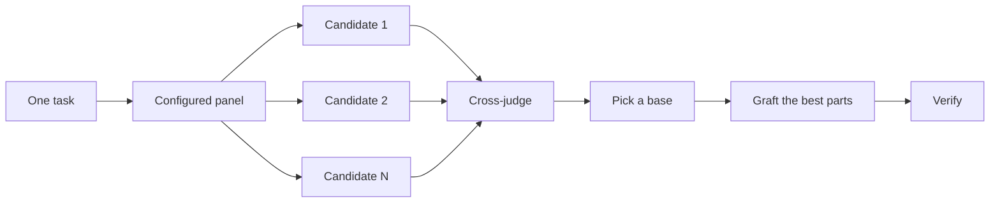

# 先设计，再写代码

对难题只做一次设计尝试，就会锁死模型想到的第一个形状。`/architect` 在实现之前把类型和边界定下来。`/arena` 对同一份需求跑多个尝试，再把最好的部分合并起来。`/interrogate` 让别的模型来试着打穿结果。当任务要的是覆盖面而不是设计综合时，`/swarm` 把切片铺开或让几路赛跑，再汇总结果。

最常见的两个设计错误：拿智能体的第一版设计就用，以及打磨一份没有任何代码验证过的计划。这一页把两个都治了。你通过代码来做计划。原型回答悬而未决的问题，README 或教程定下目标，书面计划放在最后。


## 用 `/architect` 定下形状

```text
/architect design the import pipeline before writing any code. i care most about how callers use it.
```

[`/architect`](../../skills/architect/SKILL.md) 先给自己打底：对设计涉及的代码跑 `/how`，当设计会移动归属或分层时再跑 `/why`。然后它跑 `/arena` 产出互相竞争的设计草图，每份草图先写调用方的用法，再写类型、签名和模块图。

默认情况下，它从综合出的设计直接进入实现。如果你想先看设计，就说出来：

```text
/architect with checkpoint. stop and show me before implementing.
```

代码一开写，设计就不再神圣。如果实现过程中同一个绕行方案出现在互不相关的地方，或者类型只有靠 `any` 或强制转换才能编译，`/architect` 会把这当作设计错了的证据。它会扔掉草图重来，而不是绕着它打补丁。

## 用 `/arena` 铺开多个尝试

```text
/arena take my prompt to the arena verbatim. i want to compare their proposals with yours.
```

[`/arena`](../../skills/arena/SKILL.md) 是底下那个通用工具。N 个子智能体并行尝试同一份设计或代码需求，各自写进自己的 worktree 或目录。一个来自不同模型家族的只读裁判按评分标准给每个候选打分。当另一个家族没有模型能跑时，协调者跳过裁判，自己挑基底。协调者从头到尾读完每个候选，挑一个基底，把落选者里最好的想法嫁接进来，然后验证结果。



面板来自你的 [`/setup-pstack`](../../skills/setup-pstack/SKILL.md) 配置，你也可以按任务调整。决定越重要，就要越多候选；不重要就少要几个：

```text
/arena this, 5 candidates. the cache key format is expensive to change later.
```

## 用 `/swarm` 覆盖切片和赛跑

```text
/swarm check every package under packages/ against its check.sh. one worker per package. one report.
```

[`/swarm`](../../skills/swarm/SKILL.md) 把 N 个 worker 铺到互相独立的切片、覆盖矩阵、gauntlet 通道、探索分区或事先声明的赛跑分支上。每个 worker 拿到自己的范围和检查，然后报告 `PASS`、`ISSUES` 或 `BLOCKED`。父级等所有 worker 结束，返回一份紧凑的报告，带上缺口和掉队的部分。

当你需要并行换来覆盖面，或者让互相独立的检查赛跑时，就用它。`/arena` 给每个 worker 同一份设计或代码需求，然后挑基底、嫁接最好的部分。`/swarm` 覆盖切片，或者跑一场事先声明选择规则的赛跑。它不走挑基底和嫁接那套仪式。

## 用 `/interrogate` 打穿它

```text
/interrogate the whole branch, but skeptically. no nitpicks unless it's an actual bug or regression.
```

[`/interrogate`](../../skills/interrogate/SKILL.md) 把改动和它的意图交给配置模型上的对手，每个对手都对着真实代码跑一遍，试着打穿它。不同的对手会找到不同的失败。一条发现只有在重跑它的命令能复现出违背意图的失败时才成立。报告列出每一条已验证的发现和找到它的对手，然后列出每个对手丢弃了什么、为什么，并且什么都不改。

Dropped 列表也要读。你可以推翻裁决。

## 用原型代替争论

永远不要拿第一版设计。要几个，从你看得见的证据里挑：

```text
/poteto-mode prototype a few options for the new dropdown menu. take screenshots or videos for me to compare.
```

[Prototype 作战手册](../../skills/poteto-mode/playbooks/prototype.md) 在临时目录里搭一次性草图，把各个变体放在一个切换器后面，逐个驱动，截下截图或记录耗时。它对行为和算法同样管用，不只是 UI。原型就是用代码做计划。它让智能体靠跑点东西来回答自己的悬而未决的问题，而不是来问你，也给你留出没想到的选项的空间。

同样的思路可以放大到真正的设计。把 `/architect` 和原型配在一起，留一道评审关卡：

```text
/poteto-mode we need rate limiting for external webhooks. /architect it first, and answer open questions with prototypes. let me review before proceeding.
```

别把对手浪费在抽象的计划上。`/interrogate` 会丢掉每一条跑不出来的发现，所以背后没有代码的计划没什么可让它们打穿的。让原型把问题定下来，再评审实际建出来的东西。

## 共享代码先写 README

对于别的代码会用的包或 API，从用户会读的那份文档开始：

```text
/poteto-mode write a tutorial for how i would use the new config package first. then /teach me why it beats the current one.
```

先写教程会逼出调用方的视角。你向一个假想的用户描述 API，再倒推回实现。这份文档也成了智能体检查自己工作的具体目标。当文档本身很重要时，点名 [`/technical-writing`](../../skills/technical-writing/SKILL.md)，这样教程就还是教程，不会滑成参考和解释混在一起。

## 设计定下来之后再计划

pstack 故意没有计划技能。当你确实想要一份书面计划时，等设计定下来再要：

```text
/poteto-mode turn this design into a plan. small verifiable PRs, each with its own verification steps.
```

[Multi-phase plan 作战手册](../../skills/poteto-mode/playbooks/multi-phase-plan.md) 先用原型把剩下的悬而未决的问题定下来，然后每个 PR 写一节，每节都以改动可用的证据收尾。光有测试套件通过不算这种证据。计划就是交付物。作战手册不实现它，并指明接下来该由哪个执行作战手册来跑它。

对于迁移，在提示里把标准说清楚：

```text
/poteto-mode plan the migration of our ui library to the new styling system. small verifiable PRs, each with visual regression checks. the result must match the original exactly, bugs included.
```

"bugs included" 让迁移不会顺手悄悄修掉东西，否则新旧输出就没法比较了。对于跨很多天的项目，你可以把计划提交进仓库放一阵子，让别的智能体看到进行中的工作。工作落地后删掉它。

## 一个任务该花多少设计功夫？

你可能在想是不是每个改动都需要这些。不是。大多数改动一样都不需要。一个粗略的梯子：

- 一个小的、已经完成的改动，你拿不准，只需要 `/interrogate`。
- 跨函数边界或移动归属的改动值得 `/architect`，它会顺带带上 `/arena`。
- 一个独立的决定，独立尝试会有帮助，比如命名、格式或算法，直接上 `/arena`。
- 一个覆盖矩阵、一组并行检查，或者一场声明了分支的赛跑，用 `/swarm`。
- 一个你能靠跑点东西回答的悬而未决的问题，比如布局、耗时或做法，给个原型，不要争论。
- 一个有争议、反转代价很高的设计，先 `/architect`，发布前再 `/interrogate`。
- 跨好几个 PR 的工作，要一份计划，在设计定下来之后写。

`/poteto-mode` 已经应用了这个梯子。跨边界的工作会自己触发 `/architect`，所以你直接伸手去用这些，主要是当你想要比默认更多或更少的审视时。

下一节：[构建并清理改动](./05-build-and-clean.md)。
