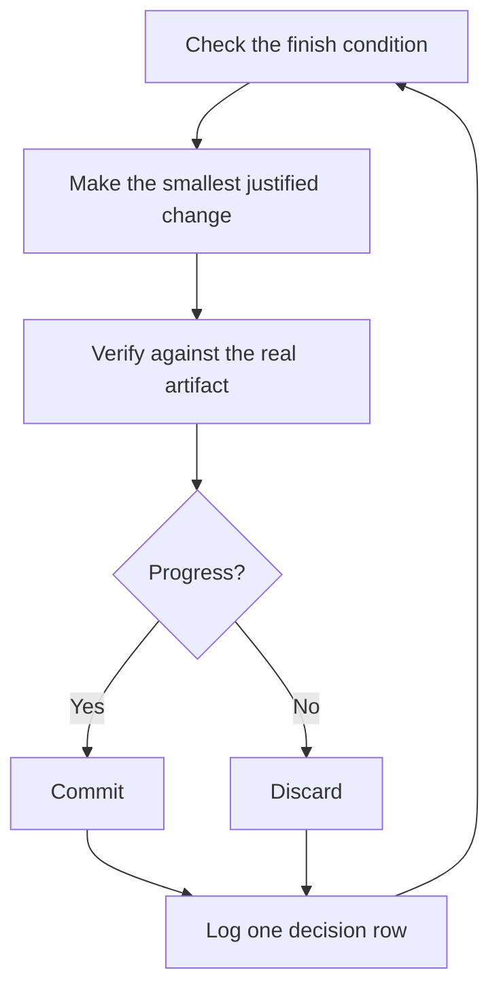

# 睡觉时让工作继续跑

这是前面所有内容的回报。一个你能信任它会验证自己工作的智能体，就是一个你可以放心丢给它一个硬任务的智能体。让它安全靠的不是希望，而是一个可检查的完成条件、一个隔离的 worktree 或云端智能体，以及一份你早上审阅的决策日志。


## 先赢得信任，再上循环

你不信任的循环只会更快地产出没人检查的工作，而且每迭代一次，烂摊子就滚大一圈。在放任一个循环自己跑之前，先确认它配得上这份信任：

- 你亲手做过一次这个任务，或者看着智能体做过一次，所以你知道做好是什么样。
- 智能体手里有你本来会用的工具和信号：验证技能、profiler、日志。
- 每个阶段都证明自己的工作，工作不达标时能叫停整条线。
- 你读过几份 transcript，把反复出现的失败变成了工具、技能或检查。

四条都成立之后，才让循环自主运行。在那之前，盯着它跑。

## 过夜契约

好的交接包含目标、完成条件、权限和一条逃生通道。不用写很长：

```text
/poteto-mode im going to bed. migrate every caller to the new parser in a fresh worktree off <base>.
done means zero old callers, all parser fixtures pass, old api deleted.
keep a decision log. don't ask me before committing.
/loop until done. if you're truly stuck after a few hours, stop and write up why.
```

逐行看看每一句给你换来了什么：

- "im going to bed" 是会话级覆盖。智能体不再问你，继续往下做。
- "done means..." 把目标变成每一轮迭代都能跑的检查。
- "fresh worktree off `<base>`" 让这次运行不会和你开着的其他东西撞车。
- "don't ask me before committing" 提前回答了智能体本来会卡住等你的那个权限。
- `/loop` 是 Cursor 内置的唤醒机制，不是 pstack 技能。[Autonomous run 作战手册](../../skills/poteto-mode/playbooks/autonomous-run.md)用它按事件或心跳重新检查完成条件。
- 逃生通道让它能在真正走不通时停下来，写清楚为什么，这比八小时富有创造性地重新诠释目标强多了。

因为你离开之后还要审这份工作，`/poteto-mode` 会把它交给 [`/figure-it-out`](../../skills/figure-it-out/SKILL.md)，由后者在写任何代码之前设计好这次运行的各个阶段，并接上决策日志。

要主动停掉一次运行，就告诉智能体暂停，或者告诉它你即将离线或重启 Cursor。[Pause safely 作战手册](../../skills/poteto-mode/playbooks/pause-safely.md)会完成或退出当前步骤，提交一个进行中的检查点，并写一条续跑说明。新开的对话通过 Session pickup 作战手册从这条说明接着干。说 "keep going" 永远不会触发暂停。

## 循环整夜在做什么



一次改动，一次检查，一行日志，每一轮都如此。没帮上忙的改动直接丢弃，不留着凑数。进入平台期意味着换方向，不是停下，完成条件也永远不会悄悄放宽来宣布胜利。

## 早上的审计

[`/show-me-your-work`](../../skills/show-me-your-work/SKILL.md) 是让这次运行可审的关键。每一行记录时间、阶段、决策、理由、证据指针和结果，写在 `decisions.tsv` 这个 TSV 里（当多次运行共用一个目录时，写在 `.audit/<task-slug>.tsv`）。默认只留在本地。当工作足够大，审阅者需要这条轨迹才能信任结果时，就把它提交。

你回来之后，用审阅的形式要这次运行的汇报：

```text
/show-me-your-work catch me up on what you did last night
```

技能交出总结之前，会派一个不同模型家族的审阅者去读轨迹和 transcript，回复末尾会有一个 Attention 部分，列出值得你细看的地方。先读那一部分，再读它指向的日志行。你审的是决策，不是把整晚重读一遍。

想要快速状态而不是完整审计，就在跑这项工作的那个对话里运行 [`/ketchup`](../../skills/ketchup/SKILL.md)。它只读不写，用大白话告诉你自你上条消息以来改了什么，附上工作产出的截图和小图。然后它列出每一个等你拍板的事项，比如合并、批准、或在几个选项之间做选择，附上它的选择、证据和风险，让你光看回复就能决定。

## 当这一夜排的是队列，不是单个任务

上面的契约是把一个任务推到一个完成条件。有些夜晚装的东西更多，一串互相独立的改动，或者一整个项目。三份作战手册把同样的信任放大。

[Autopilot-full](../../skills/poteto-mode/playbooks/autopilot-full.md) 把一串独立的 PR 一路跑到合并。每个 PR 有一个负责智能体，从构建一路带到合并，而且没有哪个负责人凭自己的判定就合并。一群全新的验证者检查负责人那个代码就绪的 head。之后的 rebase 或小修只派一个全新验证者，只有出现新行为或大的新 diff 才重新召集整个 swarm。只有对将要合并的那个 patch 给出干净判定，才授权合并：

```text
/poteto-mode full autopilot on this queue. each item is independent. i want them merged by morning.
```

[Autopilot-stack](../../skills/poteto-mode/playbooks/autopilot-stack.md) 是去掉合并的 Autopilot-full。你醒来看到的是已验证的 PR，每个都带判定，由你自己审阅并合入。一个 PR 只堆叠在它所基于的 PR 上。当你希望在任何东西合并之前亲眼过一遍工作时，选它而不是 Autopilot-full：

```text
/poteto-mode autopilot these five changes, but don't merge. i'll land them in the morning.
```

[Orchestrate](../../skills/poteto-mode/playbooks/orchestrate.md) 面向比任何单个智能体活得更久的项目：跨多天、大量堆叠的 PR、在一个常驻协调对话下的一群子智能体。协调者决定每块工作由哪个智能体做，检查每个智能体产出什么，自己从不写代码。如果一个智能体在一个会话里就能干完，作战手册本身会把你送回上面的过夜契约：

```text
/poteto-mode orchestrate the store migration. own it until every package is converted and merged. i'll check in twice a day.
```

## 并行跑多个项目

一个 [Cursor Project](https://cursor.com/blog/projects) 给一个协调智能体一条常驻线程。协调者不写代码。它指挥子智能体，子智能体默认在云端运行，所以你合上笔记本工作也继续。这正是 Orchestrate 作战手册期待的形状。给协调者的提示词以 `/poteto-mode` 开头，它派出的子智能体就会遵循这些作战手册。

几个习惯会有帮助：

- 每块工作给它自己的 Project，比如一个功能、一次迁移、一轮性能优化、或一次技术债清理。几个可以并排跑。
- 把相关的对话拖进 Project，包括已经结束的。它们会成为其中每个智能体的上下文。
- 每个 PR 合并前都配一个验证 swarm，让 Autopilot-stack 或 Autopilot-full 带队列。
- 向协调者要一个由数据支撑的计划，让它用原型回答悬而未决的问题，而不是来问你。

一条提示词就能带起整个 Project，从调研到执行：

```text
/poteto-mode refactor this repo so its architecture is more agent friendly. use /correct and /architect on past commits and review comments to find the mistakes agents make most here. use /recall for context from past chats. answer open questions with prototypes instead of asking me. come back with a plan backed by real data. once i approve it, run it with autopilot-stack or autopilot-full, and ask me which.
```

## 让循环自己启动

上面每个循环都还在等你来启动。定时或事件驱动的自动化去掉了这一步。软件维护天然分成适合这么做的几个阶段：分诊一个报告、复现它、修它、验证修复。两条规则让这样的流水线值得信任：

- 每个阶段都能叫停整条线。分诊可以判定报告是预期行为，复现可以复现不出来，修复者可以判断改动风险太大。每种结果都有用，因为它挡住了坏工作流到下一阶段，在那里撤销的代价更高。
- 每个阶段都交接证据。复现附上故障状态的截图和视频，修复附上前后对比的证明。这样人可以先确认智能体修对了东西，再去看一行代码。

pstack 把这做成一个休眠的 [automation pack](../../automations/benny/README.md)，用于 Slack issue 报告。一个自动化分诊每份报告。另一个复现已确认的 bug，并可能准备一个小草稿修复。让一个智能体去看它的 [`FOR_AGENTS.md`](../../automations/benny/FOR_AGENTS.md)，并指定目标仓库来把它设置起来。

**坑：**时长不是完成条件。"work on this for 4 hours" 没给智能体任何可检查的东西，你醒来看到的会是四小时的动作，而不是结果。给 `/loop` 一个能通过也能失败的谓词。

下一步：[用原则名字来掌舵](./08-principles.md)。
