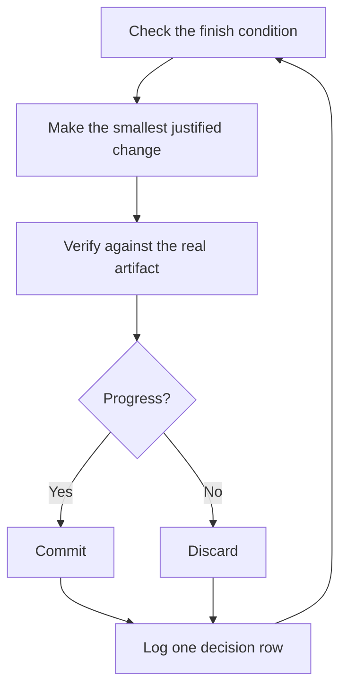

# 在你睡觉时跑工作

这是前面一切的回报。一个你能信任它验证自己工作的 agent，就是一个你可以留它独自面对难任务的 agent。让这件事安全的，不是希望。是一个可以核对的完成条件，一个隔离的工作树或云端 agent，以及一份你早上审计的决策日志。


## 先赢得信任，再上循环

一个你不信任的循环，只是更快地生产未经核对的工作，而且乱会随着每一次迭代叠加。在你留一个跑着离开之前，确认它已经赢得了这份信任：

- 你亲手做过一次这个任务，或者看过一个 agent 做它，所以你知道好是什么样。
- agent 拥有你自己会用的工具和信号：验证 skill、性能分析器、日志。
- 每个阶段都证明自己的工作，并能在工作没达到标准时停下整条线。
- 你读过几份对话记录，并把反复的失败变成了工具、skill 或检查。

只有这四条都成立之后，才让循环自主。在那之前，看着它跑。

## 通宵约定

一次好的交接有目标、完成条件、权限，以及一个逃生口。它不必很长：

```text
/poteto-mode im going to bed. migrate every caller to the new parser in a fresh worktree off <base>.
done means zero old callers, all parser fixtures pass, old api deleted.
keep a decision log. don't ask me before committing.
/loop until done. if you're truly stuck after a few hours, stop and write up why.
```

逐行走一遍每一行给你买到什么：

- “im going to bed” 是一次会话覆盖。agent 不再询问，继续往下做。
- “done means...” 把目标变成每一次迭代都能跑的核对。
- “fresh worktree off `<base>`” 让这次运行不会和你打开的任何其他东西相撞。
- “don't ask me before committing” 预先回答了 agent 否则会阻塞在上面的那个权限。
- `/loop` 是 Cursor 内置的唤醒机制，不是一个 pstack skill。[自主运行行动手册](../../skills/poteto-mode/playbooks/autonomous-run.md)用它在事件或一次心跳上重新检查完成条件。
- 逃生口让它在真正的死胡同停下，并写明为什么，这胜过八个小时创造性地重新解释目标。

因为你会在走开之后评审这份工作，`/poteto-mode` 把它经由 [`/figure-it-out`](../../skills/figure-it-out/SKILL.md) 路由，后者在任何代码之前设计这次运行的阶段，并接上决策日志。

要有意停掉一次运行，告诉 agent 暂停，或者你即将离线或重启 Cursor。[安全暂停行动手册](../../skills/poteto-mode/playbooks/pause-safely.md)完成或退出当前步骤，提交一个进行中的检查点，并写一张恢复说明。一个新对话通过会话接手行动手册，从那张说明把工作接起来。说 “keep going” 从不会触发暂停。

## 循环整夜做什么



一次改动，一次核对，一行日志，每一次迭代。没有帮助的改动被丢弃，不会留着搭便车。平台期意味着转向，不是停止，完成条件也从不会悄悄放宽来宣布胜利。

## 早晨的审计

[`/show-me-your-work`](../../skills/show-me-your-work/SKILL.md) 让这次运行可以被评审。每一行记录时间、阶段、决定、理由、一个证据指针和结果，写在 `decisions.tsv` 的一份 TSV 里（当好几次运行共享一个目录时，是 `.audit/<task-slug>.tsv`）。它默认留在本地。当工作大到评审者需要这条轨迹才能信任结果时，把它提交。

你回来之后，以评审的形式要这次运行：

```text
/show-me-your-work catch me up on what you did last night
```

在这个 skill 交回摘要之前，它在另一个模型族上拉起一个评审者来读轨迹和对话记录，回复以一个 Attention 节结束，列出值得你审视的东西。先读那一节，再读它指向的日志行。你在审计决定，不是把整夜重读一遍。

想要一份快速状态而不是一次审计，在跑这份工作的对话里运行 [`/ketchup`](../../skills/ketchup/SKILL.md)。它只读，用白话告诉你自你上一条消息以来变了什么，并带上工作产出的截图和小图。然后它列出每一件正等你处理的事，例如一次合并、一次批准，或在几个选项之间做选择，并带上它的选择、证据和风险，这样你只凭这条回复就能决定。

## 当这一夜装的是一个队列，而不是一个任务

上面的约定把一个任务推到一个完成条件。有些夜里装得更多，一个相互独立的改动队列，或一整项工程。三份行动手册把同一份信任放大。

[Autopilot-full](../../skills/poteto-mode/playbooks/autopilot-full.md) 把一个相互独立的 PR 队列跑到已合并。每个 PR 有一个负责人 agent，把它从构建带到合并，没有任何负责人凭自己的裁决合并。一群全新的验证者检查负责人那个代码就绪的 head。之后的一次变基或小修复得到一个全新的验证者，只有新行为或一大份新 diff 才会再次叫来整群 swarm。只有对将要合并的那份补丁的一份干净裁决，才授权这次合并：

```text
/poteto-mode full autopilot on this queue. each item is independent. i want them merged by morning.
```

[Autopilot-stack](../../skills/poteto-mode/playbooks/autopilot-stack.md) 是去掉合并的 Autopilot-full。你醒来时看到已验证的 PR，每一个都带着自己的裁决，你自己评审并合入。一个 PR 只叠在它所基于的那个 PR 上。当你想在任何东西合并之前用自己的眼睛看过，就选它而不是 Autopilot-full：

```text
/poteto-mode autopilot these five changes, but don't merge. i'll land them in the morning.
```

[编排](../../skills/poteto-mode/playbooks/orchestrate.md)用于一项比任何单个 agent 都活得久的工程：跨多日、许多堆叠的 PR、在一个常设协调者对话之下的成队子 agent。协调者决定哪一个 agent 做每一块工作，检查每一个产出了什么，并且自己从不写代码。如果一个 agent 能在一次会话里做完这份工作，行动手册自己会把你送回上面的通宵约定：

```text
/poteto-mode orchestrate the store migration. own it until every package is converted and merged. i'll check in twice a day.
```

## 并行跑很多项目

一个 [Cursor Project](https://cursor.com/blog/projects) 给一个协调者 agent 一条持久的线程。协调者不写代码。它指挥子 agent，子 agent 默认在云端运行，所以笔记本合上时工作仍在继续。这就是编排行动手册所期望的形状。给你发给协调者的提示词以 `/poteto-mode` 开头，它拉起的子 agent 就遵循行动手册。

几条习惯有帮助：

- 给每一块工作自己的 Project，例如一个功能、一次迁移、一次性能推进，或一次技术债清理。好几个可以并排跑。
- 把相关对话拖进 Project，包括已经结束的。它们成为里面每个 agent 的上下文。
- 在每个 PR 合并之前给它一次验证 swarm，并让 Autopilot-stack 或 Autopilot-full 带走队列。
- 向协调者要一份有数据支撑的计划，并让它在问你之前用原型回答开放问题。

一条提示词可以承载一整个 Project，从研究一直到执行：

```text
/poteto-mode refactor this repo so its architecture is more agent friendly. use /correct and /architect on past commits and review comments to find the mistakes agents make most here. use /recall for context from past chats. answer open questions with prototypes instead of asking me. come back with a plan backed by real data. once i approve it, run it with autopilot-stack or autopilot-full, and ask me which.
```

## 让循环自己启动

上面的每个循环仍然等你来启动。一次定时的或事件驱动的自动化去掉这一步。软件维护分成很适合这样做的阶段：对一份报告分诊，复现它，修复它，验证修复。两条规则让这样一条线值得信任：

- 每个阶段都能停下整条线。分诊可以判定报告是预期行为，复现可能复现不出来，修复者可以判定改动风险太高。每一种结果都有用，因为它让坏工作到不了下一阶段，而下一阶段撤销的代价更高。
- 每个阶段都交出证据。复现附上损坏状态的截图和视频，修复附上改前改后的证明。人就可以在读一行代码之前，核对 agent 修的是对的那件事。

pstack 把这作为一套休眠的[自动化包](../../automations/benny/README.md)提供，用于 Slack 的问题报告。一个自动化对每份报告分诊。另一个复现已确认的 bug，并可能准备一份小的草稿修复。让一个 agent 指向它的 [`FOR_AGENTS.md`](../../automations/benny/FOR_AGENTS.md)，并点名目标仓库来设置它。

**陷阱：** 一段时长不是完成条件。“在这上面干 4 个小时”没给 agent 任何可核对的东西，你会醒来看到四个小时的动作，而不是一个结果。给 `/loop` 一个能够通过或失败的谓词。

下一篇：[用原则名字掌舵](./08-principles.md)。
